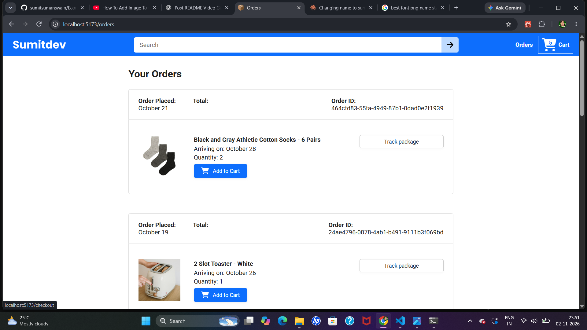
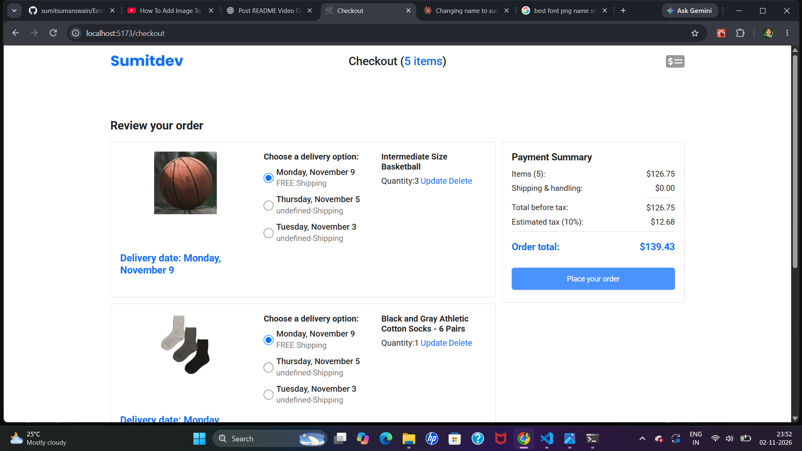
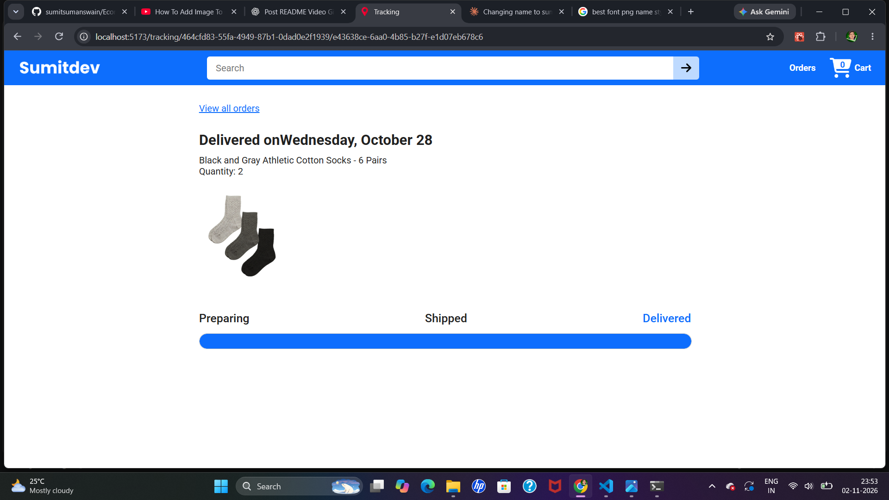
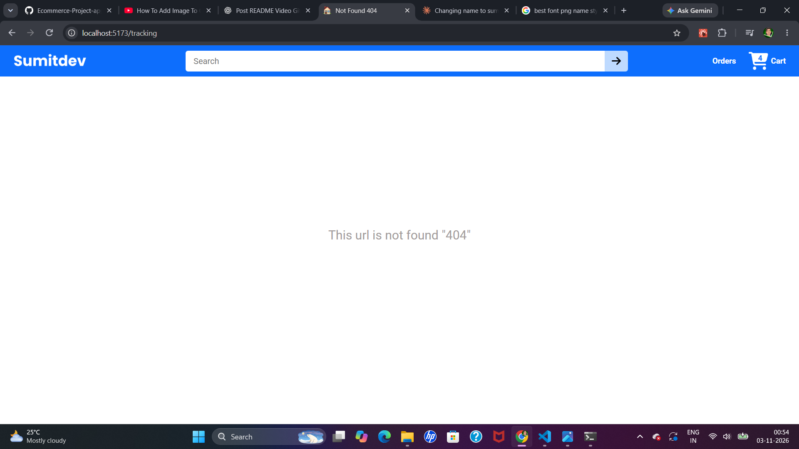

🛒 E-Commerce Project Website

A responsive e-commerce web app built with **React JS** and **TypeScript** also using **backend API** data .

✨ Features
- **Modern Header** – Brand logo, search bar, Orders link, and Cart icon in one clean blue navbar.
- **Backend Data Fetching** – Product details, names, images, prices, and ratings are loaded from the backend API, not hard-coded.
- **Product Search** – Type a keyword and click the arrow button to find products quickly.
- **Product Grid** – Products appear in a neat, responsive grid layout.
- **Product Details** – Each card shows the image, name, star rating, and review count.
- **Star Ratings** – Visual ratings (e.g., 4.5 stars) help users judge product quality.
- **Quantity Selector** – A dropdown lets users choose how many items to buy.
- **Add to Cart** – One click adds the selected quantity to the cart.
- **Live Cart Counter** – The cart badge updates instantly with the total items.
- **Orders Page** – Users can view their order history.

  🛠️ Tech Stack
  - React JS
  - TypeScript
  - Javascript
  - HTML
  - CSS
  - Vite

🔌 How It Works
1. The React frontend sends a request to the backend API.
2. The backend returns product data as JSON.
3. TypeScript types keep the data safe and predictable.
4. React renders the data as product cards on the page.

🌐  If you test my code in you code editor then Download zip file in my **gitub** account past it .
    Run the code in terminal command->

➡️ go to project folder " cd Ecommerce-project-js " 
➡️ then run code " npm run dev "

HOME-PAGE =>

.png)

ORDER-PAGE =>

CHEKOUT PAGE =>

TRACKING PAGE =>

NOT-FOUND-PAGE =>
This page if you type any wrong **url** show the page not found.

